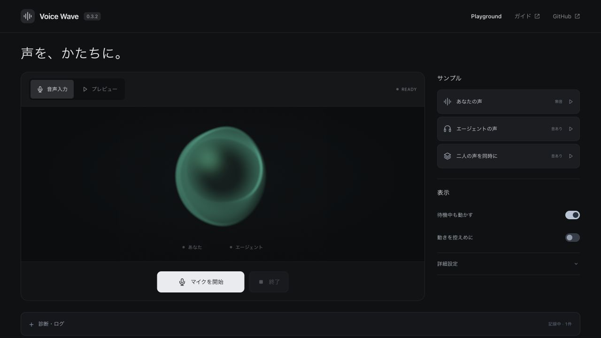

# Voice Wave

声に反応するReact部品と、ブラウザで試せるデモ。

[デモ](https://dj-thank.github.io/voice-wave/) · [English](README.md) · [API](docs/API.md)



あなたの声は赤、エージェントは青、待機はミント。思考中は青がゆっくり明滅します。同時に話すと、後から加わった声の色が同じWaveへ入ります。

## 試す

「マイクを開始」で話すか、サンプルを再生します。「プレビュー」では音を出さずに5つの状態と発話順を確認できます。「待機中も動かす」と「動きを控えめに」は別々に切り替えられます。「終了」で入力・再生・プレビューを停止します。

音声はブラウザ内で処理します。「診断・ログ」は状態と数値だけをメモリに保持し、録音は含みません。エージェントのサンプルと[会話動画](docs/DEMO_VIDEO.md)は事前に用意した音声です。

## Reactで使う

React 18.3〜19に対応。部品はGitHub Releaseから導入できます。

```sh
npm install https://github.com/dj-thank/voice-wave/releases/download/v0.3.2/dj-thank-voice-wave-0.3.2.tgz
```

```tsx
import { VoiceConversation } from '@dj-thank/voice-wave';

<VoiceConversation
  input={{ speaking: true, level: 0.6, bands: [0.3, 0.6, 0.2] }}
  output={{ speaking: false, level: 0, thinking: false }}
  style={{ width: 320, height: 320 }}
/>;
```

発話状態・音量・帯域を渡して表示します。部品自身はマイクを取得しません。詳細は[API](docs/API.md)と[最小導入例](examples/minimal-react/)を参照してください。

## 開発

Node.js 24を使います。

```sh
npm ci
npm run prepare:assets
npm run dev
```

`http://127.0.0.1:4317/`で開きます。確認は `npm test`、`npm run build`、`npm run test:package`。コード整形は `npm run format` です。

| ディレクトリ      | 役割                             |
| ----------------- | -------------------------------- |
| `src/playground`  | ページ・操作部品・プレビュー制御 |
| `src/visualizer`  | 再利用する描画部品               |
| `src/audio`       | マイク・再生・発話判定           |
| `src/diagnostics` | 件数を制限した診断ログ           |
| `scripts`         | 素材準備・配布検証・動画作成     |

[検証状況](docs/STATUS.md) · [BSD-2-Clause](LICENSE) · [依存素材のライセンス](THIRD_PARTY_NOTICES.md)
