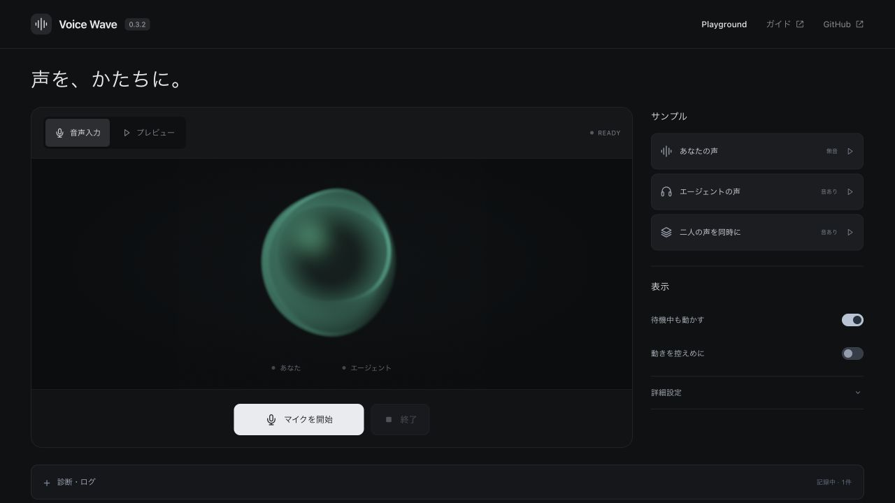

# Voice Wave

An audio-reactive React visualizer and a browser voice playground.

[Demo](https://dj-thank.github.io/voice-wave/) · [日本語](README.ja.md) · [API](docs/API.md)



User speech is red, agent speech is blue, and waiting is mint green. Thinking pulses in blue. When voices overlap, the joining speaker's color flows into the same Wave.

## Try it

Start the microphone, play a sample, or select **プレビュー** to explore the five states without audio. Waiting motion and reduced motion have separate switches. **終了** stops input, playback and preview.

Audio is processed in your browser. Diagnostics are optional in-memory state/level logs; they contain no recordings. The agent sample and [conversation film](docs/DEMO_VIDEO.md) use prepared speech.

## React

Install the latest renderer release. React 18.3–19 is required.

```sh
npm install https://github.com/dj-thank/voice-wave/releases/download/v0.3.2/dj-thank-voice-wave-0.3.2.tgz
```

```tsx
import { VoiceConversation } from '@dj-thank/voice-wave';

<VoiceConversation
  input={{ speaking: true, level: 0.6, bands: [0.3, 0.6, 0.2] }}
  output={{ speaking: false, level: 0, thinking: false }}
  style={{ width: 320, height: 320 }}
/>;
```

Supply your own activity, level and optional frequency bands. The renderer does not open a microphone. See the [API](docs/API.md) and [working example](examples/minimal-react/).

## Development

Use Node.js 24.

```sh
npm ci
npm run prepare:assets
npm run dev
```

Open `http://127.0.0.1:4317/`. Run `npm test`, `npm run build` and `npm run test:package` to verify a change; `npm run format` formats the source.

| Directory         | Responsibility                            |
| ----------------- | ----------------------------------------- |
| `src/playground`  | Page, controls and preview sessions       |
| `src/visualizer`  | Reusable rendering components             |
| `src/audio`       | Capture, playback and speech activity     |
| `src/diagnostics` | Bounded event log                         |
| `scripts`         | Assets, package checks and film authoring |

[Verification](docs/STATUS.md) · [BSD-2-Clause](LICENSE) · [Third-party notices](THIRD_PARTY_NOTICES.md)
